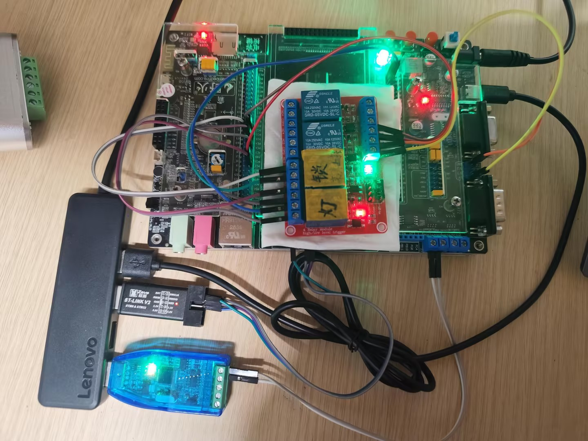
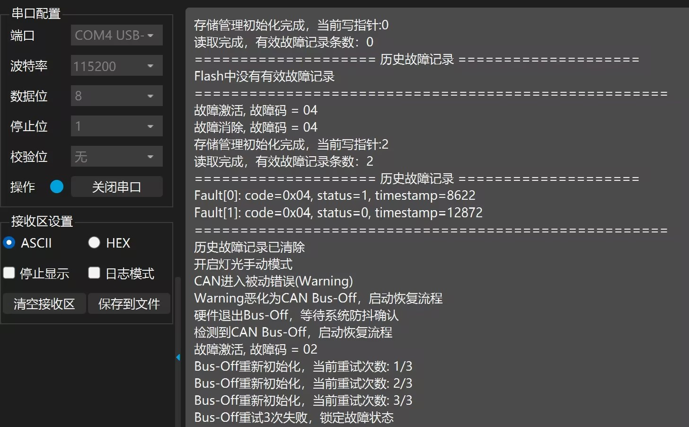
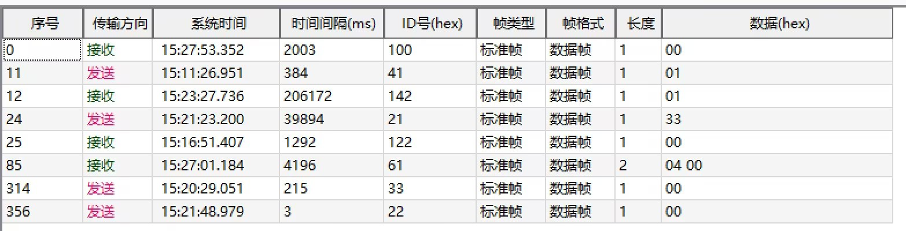

# STM32车载BCM车身控制器原型
基于 STM32F1 平台与 FreeRTOS 操作系统，采用「应用层 - 服务层 - OSAL 抽象层 - 驱动层」四层解耦架构开发的车载 BCM 原型项目。重点实现驱动封装、多任务隔离、CAN 通信可靠性、故障掉电存储与系统监控，侧重工程化架构与高可靠设计，为车载嵌入式开发实训项目。

## 📌 项目功能
- 灯光/门锁继电器控制，支持本地按键、CAN总线远程控制
- 迎宾灯光功能：夜间解锁自动亮灯，支持按键/CAN指令抢占终止
- 环境光采集，滑动平均滤波+滞回算法稳定判定昼夜状态
- CAN2.0通信，周期心跳报文 + 事件触发状态报文，支持Bus-Off自动恢复
- 继电器NO/NC双触点回读诊断，软件防抖，故障分级声光告警
- 故障日志掉电存储（W25Q64 SPI Flash），线性追加存储+校验和防损坏
- 多任务心跳看门狗监控，任务卡死自动触发硬件复位
- 分级串口日志，多任务互斥保护，输出不乱码

## 📷 项目实拍
硬件接线全景图：


串口日志截图：


CAN上位机截图：


## 🛠️ 硬件与开发环境
### 硬件平台
- 主控：STM32F103ZET6（野火霸道V2开发板）
- 外设：双路继电器模块、USB-CAN调试器、W25Q64 Flash芯片
### 开发工具
- STM32CubeMX（外设图形化配置）
- VS Code + Arm GCC（代码编写、编译）
- CAN调试上位机、串口调试助手
- Git 版本管理

## 🧱 软件架构
采用**四层分层架构**，自上而下单向调用，降低模块耦合，方便后续移植：
1. **应用层 App**：实现车身业务逻辑，灯光/门锁/迎宾/故障联动策略
2. **服务层 Service**：通用基础组件，按键状态机、信号滤波、故障管理、CAN协议解析、存储管理
3. **OSAL层**：操作系统抽象层，封装FreeRTOS全部内核接口，更换RTOS只需修改本层
4. **驱动层 BSP**：硬件外设纯封装，GPIO/ADC/CAN/UART/Flash/IWDG，只做硬件读写无业务逻辑

## 📂 目录结构
```
BCM_STM32F1
├── docs/                # 项目文档（需求说明、软件设计、CAN协议）
├── Core/                # STM32 HAL核心代码
├── Drivers/             # HAL库驱动
├── UserApp/             # 用户业务代码
│   ├── bsp/             # 驱动层
│   ├── osal/            # 操作系统抽象层
│   ├── service/         # 服务层
│   └── app/             # 应用层
├── Middlewares/FreeRTOS # FreeRTOS源码
└── README.md
```

## 🚀 快速上手
1. 用STM32CubeMX生成基础工程，替换UserApp目录下的业务代码
2. 编译工程，通过SWD接口下载到开发板
3. 串口接PA9/PA10，波特率115200，查看系统运行日志
4. 连接CAN总线，用上位机发送控制指令，观察继电器动作与状态报文反馈

##  ✨核心设计亮点
### 1. 架构解耦与 OSAL 封装
设计 OSAL 操作系统抽象层，统一封装 FreeRTOS 消息队列、互斥锁、软件定时器与任务接口，实现业务代码与 RTOS 完全解耦，更换操作系统仅需修改 OSAL 层。
严格遵循自上而下单向调用规则；互斥锁采用静态内存分配，规避运行期堆内存碎片风险。

### 2. 执行器控制与闭环诊断
业务逻辑采用状态机管理；针对灯光、门锁执行器设计「指令下发 + 硬件回读」双通道校验机制。
通过延时稳定采样 + 软件防抖确认策略，校验目标输出与实际触点状态一致性，准确判定执行器粘连 / 开路故障并上报。

### 3. CAN 通信与总线异常恢复
采用「中断回调 + 队列上抛」的收发架构，完成报文解析、DLC 校验与信号合法性检查。
实现基于硬件错误状态的 Bus-Off 自动恢复机制：软件复位 CAN 控制器清除错误计数，连续多帧通信成功才判定总线恢复，避免瞬时故障误判。

### 4. 故障管理与可靠性存储
实现集中式 DTC 故障管理模块，所有故障独立防抖确认，滤除瞬时干扰，避免误触发告警。
基于 W25Q64 SPI Flash 实现故障日志线性追加存储，每条记录附带校验和，可识别掉电半写、数据损坏场景，保证掉电存储完整性。

### 5. 任务调度与系统监控
基于 FreeRTOS 抢占式调度完成多任务划分与优先级分级配置；共享资源采用带超时机制的互斥锁保护，防止死锁。
设计多任务心跳看门狗监控机制，区分阻塞型与非阻塞任务做存活检测；支持任务栈高水位检测，提前规避栈溢出风险。


## 📄 开源协议
本项目基于 MIT 协议开源，仅用于学习交流，**禁止直接用于实车场景**。